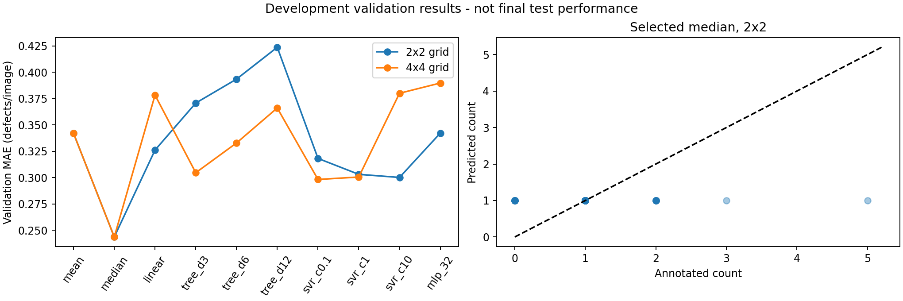

# MMA3001: Pork-rasher packaging inspection

**Status: development baseline completed; GPU detector experiments and final report pending.**
Submission deadline supplied by student: 23 October 2026.

This project studies automated inspection of RGB pork-packaging images. The detector
will output defect class, box and confidence. A separate Week-5 regression experiment
predicts the number of annotated defects per image and provides a common count-output
baseline. It does not predict meat freshness, microbial safety or certified pass/fail.

## Current evidence
- Original archive: 3,549 images, 3,123 annotations; all images decode.
- Cross-split source/hash groups quarantined: 37 images excluded.
- Cleaned splits: 3,313 train, 119 validation, 80 test images.
- Five used labels; the unused COCO supercategory ID 0 is not made a sixth class.
- 18 wrinkle training annotations; no wrinkle validation/test annotations.
- Original archive SHA256 and detailed counts: [dataset audit](results/dataset_audit.json).
- Count experiments: [results](results/baseline/summary.json), [candidate metrics](results/baseline/validation_metrics.csv).
- Median constant count baseline beats the initial learned features; see [honest findings](results/DEVELOPMENT_FINDINGS.md).
- **No final-test model predictions or detector results yet.**

## Files
| Location | Purpose |
|---|---|
| `rasher/data.py` | COCO audit, duplicate grouping, YOLO format export |
| `rasher/features.py` | Fixed RGB/gradient features, no label leakage |
| `rasher/baseline.py` | Mean/median, linear, tree, SVR and neural regression |
| `rasher/detector.py` | Optional GPU training/validation/inference CLI |
| `tests/` | Analytically checkable geometry, splitting, feature and metric tests |
| `docs/api/` | Generated HTML source documentation; open `index.html` locally |
| `docs/PROJECT_PLAN.md` | Scope, course mapping and experiment rules |
| `docs/AI_USE.md` | Honest AI contribution log and student reflection prompts |
| `results/` | Actual development results and test report |

## Setup (Windows, Python 3.12)
From a terminal in this repository:
```powershell
py -3.12 -m venv .venv
.\.venv\Scripts\python.exe -m pip install -r requirements.txt
```
For subsequent commands use `.\.venv\Scripts\python.exe` in place of `python`.
On Linux/macOS use `python3 -m venv .venv` and `.venv/bin/python`.
Dependencies are pinned for the CPU experiment; full GPU resolved dependencies must
be saved with `python -m pip freeze > results/gpu-environment.txt` after installation.

## Obtain and prepare data
Download **version 4, COCO JSON ZIP** from:
https://universe.roboflow.com/hello-2aqe0/pork-rasher-error-packaging/dataset/4
Keep the ZIP outside Git. The original file uploaded by the student is usable directly.
```powershell
python -m rasher prepare --zip "C:\path\Pork Rasher Error-Packaging-.v4i.coco.zip" --out data/prepared
python -m rasher baseline --data data/prepared --out results/my_baseline
```
Output directories must be new or empty, to avoid overwriting provenance. `data.yaml`
contains a machine-specific absolute dataset path; regenerate preparation when moving
machines. Source image filenames and raw data never become model input features.

## CPU count experiment
Target: number of annotation boxes per image (integer ground truth, continuous
nonnegative predictions). One image per source is selected for this baseline to avoid
unequal augmentation weighting. Preprocessing is fitted only on training images.
Two feature grids (2x2 and 4x4) and a small predeclared model search are compared on
validation MAE. RMSE, R2, fit time and batch prediction time are also recorded.
Selection is validation-only; the test set remains reserved.

Mean and median constant predictors matter: most images have around one annotation,
so a complex model is useful only if it beats trivial predictions. Negative R2 is
reported honestly and indicates weak performance against the evaluation-subset mean reference.



## GPU detector experiments (not yet executed)
Hardware supplied: RTX 4060 Laptop 8 GB, Ryzen 7 7435HS, 24 GB RAM.
Install GPU dependencies and confirm a CUDA-enabled PyTorch build:
```powershell
python -m pip install -r requirements-detector.txt
python -c "import torch; print(torch.__version__); print(torch.cuda.is_available())"
```
If the last command prints False, use the official Windows CUDA installation selector:
https://pytorch.org/get-started/locally/ . Training with `--device 0` requires a working GPU.

Two controlled experiments; start with 320 as the cheaper run:
```powershell
python -m rasher.detector train --imgsz 320 --epochs 50 --batch 8 --name yolov8n_320
python -m rasher.detector train --imgsz 640 --epochs 50 --batch 8 --name yolov8n_640
```
YOLOv8n pretrained weights download on first use (internet required). Batch 8 is an
initial setting, not a measured memory guarantee; reduce to 4 if CUDA runs out of memory.
Windows uses `workers=0`. Each experiment writes weights/curves under `runs/detect/`.
Actual training time and memory usage have not yet been measured.

```powershell
python -m rasher.detector validate --weights runs/detect/yolov8n_640/weights/best.pt --name validation_640
python -m rasher.detector predict --weights runs/detect/yolov8n_640/weights/best.pt --source data/prepared/images/valid --name demo
```
Only after selecting and freezing a model using validation:
```powershell
python -m rasher.detector final-test --weights runs/detect/yolov8n_640/weights/best.pt --name frozen_test --confirm-frozen-model
```
The 640 path above is an example, not a claim it is the selected model. Pass `--imgsz 320`
when evaluating a 320 experiment. Counts must eventually be compared at a validation-
selected confidence threshold, and localisation measured separately by mAP/precision/recall.

## Tests and documentation
```powershell
python -m pytest -q --junitxml=results/tests.xml
python -m pdoc rasher -o docs/api
```
Inspect [test report](results/TEST_REPORT.md). Unit tests verify implementation; they do
not establish predictive accuracy. All real model results remain separately labelled.

## Known limitations
Grouping removes identical-source and byte-identical cross-split overlap, not correlated
neighbouring video frames or shared trays. The split is **not established tray-independent**.
Missing annotations are not certified good packages. Rare classes and the 80-image test
set limit conclusions. No performance claim is made for unseen production lines.

## Licensing and AI
Original code: [MIT](LICENSE). Dataset: CC BY 4.0; attribution and dependency conditions:
[THIRD_PARTY.md](THIRD_PARTY.md). Optional Ultralytics components retain upstream terms.
AI generated most initial code/docs; details and required student reflection:
[AI_USE.md](docs/AI_USE.md). Course PDFs and credentials are not committed.

## Submission checklist (pending)
- 5-10 page report + references/appendices, submitted through Moodle.
- Accessible final GitHub link + ZIP of a full repository clone, including Git history.
- Functional main, README, HTML docs, licence, source, tests and test report.
- Presentation/interview booked separately; student must explain all decisions/results.
